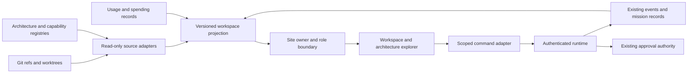

# Delta workspace refactor

Status: Phase 1 source inventory and delivery contract complete; implementation phases pending.
Inspected 2026-09-29: site main d6f4052; agent baseline checkout 35cad02.
These revisions identify inspected source, not running or deployed revisions.

## Product outcome

Delta Site is the public product presence and authenticated operating home.
An owner can request work, observe its execution, inspect evidence, and continue
it without losing the relationship between tasks, changes, tests, and costs.
Developers receive explicitly scoped access. Existing owner checks remain in force
until a separately tested role model exists; signing in alone grants no runtime authority.

## Phase 1: source inventory

Paths below are relative to the named repository. Agent paths were inspected in
delta-worktrees/delta-baseline-20260924, not the older dirty working checkout.

| Source | Existing implementation | Connection and limitation |
| --- | --- | --- |
| Architecture/capabilities | agent config/workspace-architecture.json, config/capabilities.json, config/runtime-tools.json | Existing site scripts/observatory-export.cjs projects committed main refs; does not describe deployment or live readiness. |
| Site report | site src/lib/observatoryServer.ts, src/lib/observatory-contract.cjs | Owner-verified, validated private file; no continuous source or runtime feed. |
| Branches/worktrees | agent src/system-state/integration-graph.mjs | Existing Git comparison and dirty-work classification; adapt read-only output, do not auto-merge or infer intent from path heuristics. |
| Runtime status | agent src/runtime/server.mjs GET /v1/operator/status | Authenticated process status, availability and command metrics; revision attestation still needs an explicit contract. |
| Commands/results | same server POST /v1/commands, GET /v1/sessions/:id | Existing execution path and streamed events; sessions are process-memory maps. Browser results are a transport-specific projection. |
| Operational visibility | agent src/runtime/operator-visibility.mjs | Last 100 commands in memory; eviction disclosed, external activity unknown, costs unknown. Not a durable all-system history. |
| Event lifecycle | agent src/events/hq-projection.mjs and store.mjs | Existing sanitized HQ projection includes producer, deliveries and lifecycle; reuse rather than create a second event bus. |
| Engineering | agent src/missions/engineering-mission.mjs, src/runtime/engineering-progress.mjs | Existing mission control and progress evidence; normalize references to task/run/worktree and expose supported actions only. |
| Approval authority | agent src/session/broker.mjs and owner-session.mjs | Preserve exact-action approval binding; HTTP command callers cannot submit arbitrary approvals. UI observation and UI decision authority are separate integrations. |
| Backend spending | backend provider_limits.py | Candidate source for reservations/settlements and limits; source located, live storage/configuration and billing coverage not yet qualified. |
| Graphs | site components/observatory/ArchitectureGraph.tsx; scripts/observatory-export.cjs | Systems/capabilities already supported; optional Graphify modules importer exists. Original Graphify export not located in inspected workspace paths. |

Do not read arbitrary file paths from browser input. Each adapter reads a fixed,
configured source and returns a bounded, redacted projection. Missing sources
produce unavailable/stale states, never synthetic fallback values in live views.

## Connection design

The local runtime currently uses loopback authentication and strict origin checks.
A hosted site cannot simply call the owner's localhost or inherit its credentials.
First delivery targets a local site server with a configured, authenticated runtime
adapter. Hosted connectivity requires its own deployment design; do not weaken
origin checks, publish the daemon, or place signing credentials in browser storage.

## Phase 2: shared contracts and connectors

Reuse native identifiers; preserve source-specific IDs in references. Define a
versioned read model for task, run, event, repository revision, worktree, artifact,
verification, approval request, capability availability and cost observation.

Every observation carries source, observed_at, scope, and freshness. Revisions
distinguish branch head, checkout state, integrated main, running build and deployed
build. Unknown identities remain unknown. Never join runs by title alone.

Separate token usage, estimated cost, settled provider cost and billing totals.
Include currency, accounting interval, provider, coverage and reservation state.
Prevent double-counting when the same request appears in multiple ledgers.

Acceptance: disconnected sources, stale timestamps, restart, duplicate events,
missing links and partial billing coverage render correctly. Cross-role reads and
writes are rejected server-side. No new execution authority comes from a read adapter.

## Phase 3: workspace shell

- Home: active work, recent results, attention queue, health and budget summaries.
- Work: composer, tasks, evidence, approvals, failures and supported continuation.
- System: architecture, capabilities, connections and service readiness.
- Engineering: branches, worktrees, changes, verification and integration status.
- Analytics: performance, reliability, usage and spending with coverage labels.

Persistent composer; consistent detail panel; shareable authorized entity URLs.
Keep deep evidence expandable. On small screens prioritize current task and result.
Restore the full request context from history: repository, capability, arguments,
session and execution mode. Distinguish viewing an old run from continuing it.

Acceptance: navigate task to branch to test evidence and back without losing state;
empty, failed, loading and disconnected views have clear next actions.

## Phase 4: architecture explorer

Reuse registry and Graphify data adapters; redesign interaction around progressive
disclosure: domain -> system -> capability -> handler/module. Default to a small,
readable overview. Support search, neighborhood expansion, reverse dependencies,
revision comparison and a keyboard-accessible list equivalent.

Views: declared structure, observed execution, source changes, health and usage.
Static edges never animate as execution without a correlated event. Clicking a node
opens provenance, source revision, associated runs, verification and available costs.
Graphify is supplementary static evidence, not the authoritative runtime graph.

Acceptance: identify an owning system and trace a failed run without examining the
whole graph; render missing mappings and stale module exports explicitly.

## Phase 5: complete live workflow

Submit a bounded task through the existing executor; display correlated events,
actual result and verification. Preserve history after restart using the owning
runtime's existing persistence mechanisms where suitable. Add missing persistence
only after auditing those mechanisms. Connect approvals through existing authority.
Expose continuation/cancellation only when the controller implements them.

Acceptance scenario: submit once, see progress, inspect any blocked approval,
complete through authorized control, inspect changes/tests/result, reload and
recover the run, then explicitly continue it. Duplicate clicks/reconnects must not
create duplicate work. A failed test stays visible; retries obey existing caps.
Start with a deterministic read-only task, then one bounded engineering task.
Paid execution remains separately budgeted; no automatic broad qualification runs.

## Phase 6: presentation and broader rollout

Apply consistent typography, layout and interaction patterns. Unicorn animation
is a separately scoped aesthetic integration after selecting the intended product
and confirming its runtime/accessibility requirements. Keep reduced-motion support
and avoid decorative movement in dense evidence views.

Expand connector coverage after the complete workflow passes. Keep public marketing
separate from private operational data. Hosted deployment is a distinct milestone
with authenticated connectivity, retention and measured operating costs verified.

## Delivery order and completion rule

Phase 2 begins with one read-only overview contract spanning source revisions,
capability availability and process health. Then deliver the workspace shell and
graph increment, followed by the complete task journey and presentation pass.
Each increment needs a visible usable result and focused failure-path checks.
Do not replace existing controllers, authentication, event stores or registries
merely to make their shapes uniform. Unknown coverage is a tracked gap, not a reason
to expand the framework before the current increment works.

## Open evidence gaps

- Locate or regenerate a provenance-checked Graphify export from current source.
- Qualify current spend storage and provider billing coverage read-only.
- Inventory durable mission/event retention before selecting history storage.
- Specify role permissions and the approval UI handshake before enabling decisions.
- Verify runtime/deployed revision identity instead of equating it with local HEAD.

No runtime configuration, credentials, permissions, deployment or executable code
changed in Phase 1. The development server's generated AGENTS.md addition is outside
this document's change scope.

## Phase 2 implementation: read-only foundation (2026-09-29)

Implemented `/api/hq/workspace` behind the existing exact-owner check. It combines
validated source reports with an allowlisted projection of the same daemon status
used by Workbench. Observatory Overview and Activity now include a polling runtime
panel, command evidence, verification meter, and capability observations.

Local site server configuration:
- `DELTA_HQ_REPORT_PATH`: existing private source report configuration.
- `DELTA_HQ_RUNTIME_PORT`: loopback daemon port (for example 4318).
- `DELTA_HQ_RUNTIME_TOKEN`: current daemon workbench token, server environment only.
- Existing owner identity/authentication configuration remains required.

Never commit or use NEXT_PUBLIC for the token. Restarting the daemon rotates it;
update the server environment accordingly. The adapter accepts only a numeric port,
uses a fixed loopback GET path, refuses redirects, bounds response size, applies a
five-second timeout and strips noncontract fields. The preview remains offline.
Polling is sequential at ten-second intervals after completion, stops on lost
owner access, and clears observations on request failure.

Live adapter verification read four commands and 100 capability observations from
the existing daemon. Its sanitized response is partial (the prior registry audit
reported 158), so the panel labels observations rather than claiming a full census.
Costs, running revisions and durable history remain unknown/not connected. This
increment does not implement branch joins, approval decisions or task execution;
those remain subsequent contract/workflow increments. The signed-in page has not
been verified with a real owner session; connector verification used the real daemon
separately. No persistent token configuration or deployment was performed.

## Phase 2 closure and Phase 3 entry

Sign-in/live configuration is deferred by owner instruction. Source revisions now
remain inspectable when runtime is disconnected, with source age and a clear
main-vs-running/deployed distinction. Runtime state enums are validated rather
than treated as arbitrary display text.

Ready for Phase 3: owner-protected read model, source/revision display, runtime
observations, disconnected states and shared Workbench evidence. Build verification
qualifies packaging only; it does not qualify hosted runtime connectivity.

Carry forward (do not silently mark complete):
- Durable history: reuse mission/event persistence; daemon memory is not a history store.
- Branch/task joins: add stable references at the producing controller; names are not IDs.
- Cost integration: engineering progress already reports per-task estimates and pending
  usage, but its existing writer emits HTML, not a machine-readable cross-system feed.
  Backend reservations are not settled invoices. Export a versioned projection before
  adding either to the workspace; never scrape rendered HTML for accounting.
- Hosted operation: local daemon loopback cannot be reached from a hosted site server.
  Keep connector unconfigured until the approved topology and credentials are installed.

Phase 3 should organize Home, Work, System, Engineering and Analytics around the
shared contract. Unconnected sections must explain their missing source. Do not
present synthetic task, billing or branch data as live. Existing architecture graph
remains available while its dedicated redesign proceeds in Phase 4.

## Phase 3 delivery: workspace shell

Navigation now exposes Home, Work, Engineering, System, Analytics and Settings.
Existing overview/architecture/quality hash URLs remain compatible. A persistent
New task link opens Work. Its bounded draft survives in-page navigation and clears
on reload; no browser storage or implicit execution is introduced. Engineering
shows source repositories with explicit missing branch, test and deployed-revision
connections. Work retains shared runtime observations when authenticated/configured.
System preserves the architecture explorer for the Phase 4 redesign.

Verified browser navigation Work -> Engineering -> Work with draft preserved, clear
disabled execution control, narrow-screen layout and no console errors. 245 tests,
production build and lint (four existing warnings, no errors) passed. This is the
workspace shell increment; linked task detail panels, durable history and execution
remain dependent on the later live-workflow contracts. Sign-in configuration and
hosted deployment remain deferred.

## Audience boundary amendment before Phase 4

Public pages remain public product information and shared sign-in. Personal and
Technical are separate authenticated experiences, not an elevated mode selected by
an untrusted browser toggle.

Personal: Ask Delta, My tasks, Results, Connections, Preferences. Return only the
current user's tasks, plain-language progress/failures, relevant approval requests
and applicable budget limits. Never send infrastructure graphs, other users' work,
internal paths, branch inventories or system-wide telemetry to this client.

Technical: Home, Work, Engineering, System, Analytics, Settings. `/hq` and its APIs
remain exact-owner-only today. Future analyst permission permits scoped read-only
telemetry, not source changes or approval decisions; developer permission must bind
explicit repository and execution scope. Neither inherits unrestricted personal data.
Only a server-verified permission may reveal technical navigation or data. Authentication
alone, user profile metadata, query parameters and view preferences cannot grant it.

The separate Personal design preview is available locally at
`/observatory-preview?view=personal`. The selector chooses synthetic presentation
only, behind the existing development-only route; it never switches authority.
The Personal component imports no technical projection or runtime connector.
Production personal routing and server-side user-scoped data are deferred with the
sign-in configuration. No live identity, role, permission or redirect behavior changes.

Phase 4 architecture exploration belongs exclusively in Technical -> System.
The public product narrative and Personal experience do not show its navigation.
